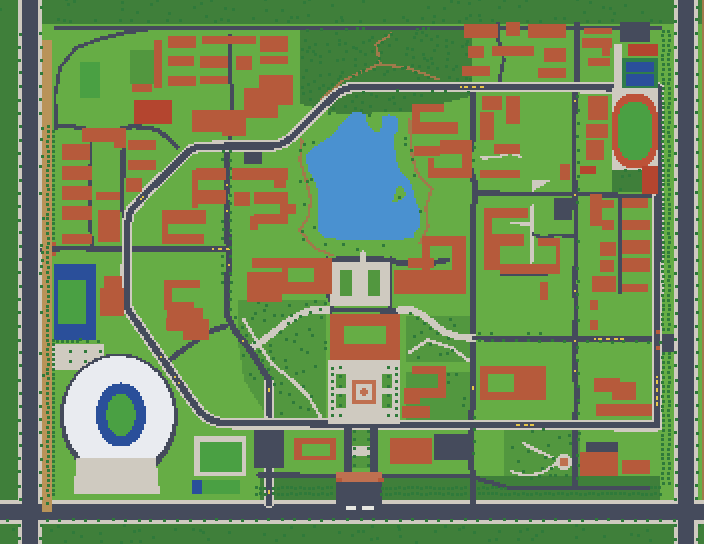

# 像素校园 · 河北工程大学新校区

星露谷风格的俯视角 2D 网页游戏，多人在线（Phaser 3 + TypeScript + Vite 客户端）。**不商用，仅个人学习。** © 2026 [EXIST-D](https://github.com/EXIST-D)，保留所有权利，条款见 [LICENSE](LICENSE)。
线上：https://exist.qd.je/pixel/　·　仓库：https://github.com/EXIST-D/PixelCampus（公开；欢迎 fork 提 PR，须经仓库主人审核才合并）

地图**平面布局以真实校园为准**（卫星正射图量测 + OSM 交叉校验：101 栋建筑、道路网、湖、运动场、三个大门；世界 704×544 格，1 格 = 2.5 m）；
画面（地面、建筑、树、人物、小猫、UI）全部由代码程序化生成，没有第三方素材（仅 Ark Pixel 12px 字体，OFL）。



## 快速开始
```bash
npm ci
npm run assets     # 生成地面块 / 图集 / 世界数据（生成物不入库；首次约 2 分钟，之后有缓存）
npm run dev        # http://127.0.0.1:5173/?offline （离线单人预览；?touch 强制手机界面，把窗口调矮就是横屏布局）
npm test           # 客户端与共享规则的测试
npm run build      # 类型检查 + 生产构建
```
**联机服务器、部署和运维不在这个仓库里**，由主人在自己电脑上维护；仓库里的 `npm run server / deploy / board / admin:set / bots` 等脚本需要那部分文件，协作者用不到。

**多人协作**：fork 本仓库、在自己的 fork 里改，提 Pull Request，CI 自动跑检查；主人审核合并，上线部署由主人手动执行。完整流程见 [docs/COLLABORATION.md](docs/COLLABORATION.md)。

## 玩法一览
走路/奔跑、骑共享单车、和校园小猫玩（好感度、跟随、猫窝）、湖边钓鱼（拉鱼小游戏、25 种鱼、图鉴）、校园商店卖鱼买东西、校园墙发帖（需管理员审核）、每日任务/成就/称号、校园跑、好友/私聊/组队、公屏/留言板/公告、拍照、表情、手持物、季节与天气、昼夜。
操作：`WASD/方向键` 移动，`Shift` 奔跑，`E/空格` 互动，`I` 背包，`H` 图鉴，`J` 成就，`Q` 任务，`T` 组队，`X` 表情，`P` 拍照，`Z` 沉浸模式，`M` 地图，`B` 留言板，`N` 公告，`F` 好友，`+/-` 缩放；手机是左半屏摇杆 + 右下角按钮。
**完整功能清单见 [docs/FEATURES.md](docs/FEATURES.md)**（每次更新同步），更新历史见 [docs/CHANGELOG.md](docs/CHANGELOG.md)。

## 目录
```
data/campus/        ★ 地图唯一数据源（改这里，再 npm run assets）：geo、terrain、buildings、pois、osm-roads
data/interiors/     室内数据（室内暂停开发，默认不开放入口）
src/                游戏客户端：scenes / entities / world / systems / ui / audio / net / art（人物小猫 Rig）/ shared（共享规则与协议）
tools/              构建期工具：world/compile.ts（蓝图→地面块+图集+碰撞）、art/（程序化像素美术）、reference/（卫星图对照）、analysis/（Python 路网分析）
tests/              vitest：蓝图完整性、地图保真度、生成世界、外观/协议/共享规则…
docs/               文档（见下）
archive/            上一版（只读，已废弃，不入库）
```

## 文档
- **[docs/HANDOFF.md](docs/HANDOFF.md) — 项目交接：现状、约定、待办、调试手册（新会话/新协作者先读这个）**
- [docs/ROADMAP.md](docs/ROADMAP.md) 开发路线 · [docs/FEATURES.md](docs/FEATURES.md) 现有功能 · [docs/CHANGELOG.md](docs/CHANGELOG.md) 更新记录
- [docs/COLLABORATION.md](docs/COLLABORATION.md) 协作流程（fork + PR）
- [docs/ARCHITECTURE.md](docs/ARCHITECTURE.md) 架构 · [docs/MULTIPLAYER.md](docs/MULTIPLAYER.md) 联机协议与各批功能设计 · [docs/ECONOMY.md](docs/ECONOMY.md) 货币/商店/校园墙设计
- [docs/MAP_PIPELINE.md](docs/MAP_PIPELINE.md) 地图管线与已知偏差（改地图前先读）· [docs/SCALE.md](docs/SCALE.md) 比例约定
- [docs/ART_STYLE.md](docs/ART_STYLE.md) 美术风格 · [docs/ART_CHARACTER_CAT_DESIGN.md](docs/ART_CHARACTER_CAT_DESIGN.md) 人物/小猫 Rig 设计 · [docs/ASSETS_AND_LICENSES.md](docs/ASSETS_AND_LICENSES.md) 素材许可
