# 人物 / 小猫美术扩展设计（2026-11-02）

> 本文是**设计与调研**，还没有改任何游戏代码。目标：更多更细的人物动作、更多服装/发型/发色的像素建模，以及更多的猫咪动作与形象。
> 美术仍然**全部程序化生成、不引入第三方素材**（见 [ASSETS_AND_LICENSES.md](ASSETS_AND_LICENSES.md)）；下面的公开资料只用来借鉴"结构与做法"，不抄像素。
> 配色预览图：[appearance-palettes.png](img/appearance-palettes.png)（第 1 行肤色 8 档、第 2/3 行自然/时尚发色各 12、第 4 行服装 24 色，下方两排是发色试穿）。

---

## 0. 一页摘要

1. **现状瓶颈不是画得不够多，而是"一个造型 = 一整套预烘焙帧"**：12 个固定造型 × 20 帧，写死在图集里。想要"发型 × 发色 × 上衣 × 下装 × 鞋 × 配饰"自由搭配，必须改成**运行时分层合成**。
2. **核心设计：Rig 驱动**。每个动作只描述"头/躯干/手臂/腿"在每帧的偏移与姿态（数据表），所有服装、发型都按 Rig 画。这样**新增一个动作 = 加一张数据表**，不用给每套衣服重画；新增一件衣服 = 加一个绘制函数，自动拥有全部动作。
3. **人物**：保持 16×32（含描边 18×34）与脚点锚点不变，所有现有机制（骑车、坐下、钓鱼、雨伞、表情）不用重做。动作从 4 向×4 帧走路，扩到 约 30 个动作（待机呼吸/眨眼、6 帧走、6 帧跑、挥手/欢呼/跳舞/大笑/难过/思考/点赞/比耶、钓鱼全流程、摸猫/喂猫、坐姿、手持物…）。
4. **外观**：发型 5→**16 种轮廓 × 5 种刘海**，发色 4→**24 色（+渐变发尾）**，肤色 4→**8**，上衣 5→**22**，下装 5→**12**，鞋 1→**8**，帽子 **9**，配饰/手持物 **各十余**。全部用**调色板编号**存（不是任意颜色），服务端好校验。
5. **小猫**：现在只有**右向侧视图**、4 个动作（走/坐/睡/吃）。设计 **约 30 个动作**（舔爪、洗脸、伸懒腰、打哈欠、挠耳朵、扑、蹭腿、揉面、打滚、小跑、叼鱼…）、**补正面/背面视角**、毛色 6→**约 20 种**（狸花、玳瑁、橘白、蓝白、银渐层、金渐层、布偶、暹罗、蓝猫、异瞳白…）、体型（胖橘/长毛/小奶猫）、耳型（立耳/折耳）、尾型、项圈/围巾等配饰，并和**好感度**联动出不同行为。
6. **一个必须避开的坑**：现有 32 只猫的毛色由 `shared/cats.ts` 的固定算法决定，且名字、好感度都挂在猫编号上——**新毛色只能给新增的猫或"变体"使用，不能让老猫突然换色改名**（见 §7.6）。
7. 分期：**P0 重构不改外观（回归测试像素一致）→ P1 动作 → P2 外观自定义 + 创建角色界面 + 联机字段 → P3 衣橱/商店/季节**；猫与人并行，C0–C3。每期都能独立上线。

---

## 1. 现状盘点（读代码得到的事实）

### 1.1 人物（`tools/art/characters.ts`、`src/entities/Player.ts`）
- 精灵 16×32，描边后每帧 18×34（+2 行投影），脚点 `(9, h-3)`，`outlinedSoft` 一次性给整个合成体描彩色柔和边。
- 外观 = 一个 `CharLook`：皮肤 4 档 / 发色 1 个 / 发型 6（含 `cap`，其实是帽子）/ 上衣 5 / 下装 5 + 眼镜、书包、耳机。颜色用 `tones()` 由一个基色自动派生 4 阶明暗（暗部偏紫、亮部偏黄）——**这个派生函数是后面"随便换色"的基础，已经验证对粉/紫/蓝/绿等时尚色同样好看**（见预览图）。
- 帧：`down/up/left/right × 4`（`left` 是 `right` 镜像）。走路动画 = `[1,2,3,0]` 循环，**帧 0 兼任站立**。没有待机动画、没有"跑"的专用帧（跑 = 走路加快 `msPerFrame` 90）。
- 预置 12 个造型，`LOOK_CHOICES` 把 12 个按性别各分 6 个；档案里存的只是一个数字 `look`（`Profile.look`），联机也是只传这个数字。
- **所有"附加表现"都是在精灵外面叠的**：骑车 = 裁掉下半身再叠车；坐下 = 抬高 + 盖一条椅面；钓鱼 = 用 `Graphics` 画竿线，手的位置写死（`cx+dx*5, cy-14`）；雨伞 = 单独 Image；表情 = 头顶图标 + 抖动/跳的 tween。**人物本体没有任何"做动作"的帧**。

### 1.2 小猫（`tools/art/cats.ts`、`src/entities/Cat.ts`、`src/shared/cats.ts`）
- 每帧 26×20，**只有朝右的侧视图**（朝左靠 `flipX`）；上/下方向猫也只会侧着走，被摸时只按 x 决定朝向。
- 6 种毛色（橘/黑/白/三花/奶牛/灰），花纹靠"圆形斑块 + 条纹点"，4 个姿势：走 4 帧、坐 2、睡 2、吃 2。
- 行为状态：`sit/walk/sleep/eat/happy/flee`；`happy` 直接复用 `sit` 动画（只是冒爱心）。速度 26 px/s（逛）/84（逃）/最高 170（跟随追人）都用同一套 4 帧走路，**逃跑和小跑没有区别**。
- 毛色、名字由 `COAT_NAMES[coat]` + 固定种子决定，好感度/专属名/猫窝挂在猫编号上，服务器按"家"的位置校验。

### 1.3 管线
- 构建期 Node 脚本（`sharp` 写 PNG）→ 货架式图集 → Phaser `load.atlas`，动画在 `BootScene.makeAnimations` 里按 `look × 方向` 建。
- `tools/art/px.ts` 的 `Img` 是纯 TS 像素缓冲，**只有 `save`/`savePreview` 依赖 `sharp`**——把这两个方法拆出去，整个绘制代码就能在浏览器里跑（运行时合成的前提，改动很小）。

---

## 2. 公开资料调研

| 主题 | 我查到的结论 | 对本项目的用法 | 来源 |
|---|---|---|---|
| **LPC 通用人物精灵表**（开源社区最成熟的"分层换装"体系） | 一张表 = 多个动作行 × 4 方向；动作包括 walk（8 帧）、run（8）、idle（2 个不同帧）、sit、emote、jump、hurt、climb、spellcast、thrust、slash、shoot 等；帧 64×64；每一层（body/head/hair/torso/legs/feet/headwear…）有各自的 z 值，渲染时按 z 从小到大叠。sit 和 emote 是"3 个关键帧各停留多次"的做法。 | 借鉴"**动作 = 行表、装备 = 带 z 的图层**"和"待机只需 2 帧 + 停留"这两个思路。**不使用它的素材**：许可是 CC-BY-SA / GPL / CC-BY 等混合，且要求署名，和"全程序化自制"的原则冲突。 | [Universal-LPC-Spritesheet-Character-Generator](https://github.com/LiberatedPixelCup/Universal-LPC-Spritesheet-Character-Generator)（我读了其 README、ARCHITECTURE、`sources/state/constants.ts`） |
| **LPC 的 Rust 合成库** | 用"图层标识符 + 颜色变体"拼出整张表，图层顺序决定遮挡。 | 佐证"按层合成 + 颜色变体"是可行的轻量做法。 | [lpcg](https://docs.rs/crate/lpcg/latest) |
| **星露谷农夫的分层** | 农夫由多层组成：头/躯干/鞋在底层，衣服、配饰、头发、帽子在其上多层绘制；裤子等有固定的整列像素覆盖头部/腿部；戴帽子时发型会自动换成另一款（防穿模）；皮肤/眼睛/鞋/裤子/袖子靠**基础图里的特定颜色**识别后再染色。 | 借鉴：①"戴帽自动换发型"（我们的 `hat` 与 `hair` 需要一张**兼容表**）；②用固定色标识区域再染色——我们已经有 `tones()` 的更直接做法。 | [Modding:Farmer sprite](https://stardewvalleywiki.com/Modding:Farmer_sprite)（⚠ 页面抓取被 403 拒绝，以上来自搜索摘要，**细节未逐条核实**） |
| **俯视角 RPG 角色包的常见帧数** | 常见 4 方向 × 4–8 帧走、4–12 帧待机、8 帧跑；16×32 + 每个动作共用同一个"脚点 pivot"，保证运行时切动画角色不漂移。坐/躺/表情在多数包里**不是标配**，是玩家常求的"额外项"。 | 采用：**所有动作共用同一脚点**（我们已经是），新增动作不得改锚点。 | [2D pixel art top-down character template](https://zegley.itch.io/2d-pixel-art-top-down-character-template)、[Moonforge pixelart characters base](https://moonforgestudios.itch.io/pixelart-characters-base)、[tampg 2D explorer](https://tampg.itch.io/2d-explorer-character-sprite) |
| **像素猫动画套路** | 成品包里常见：待机（站/坐 8 帧）、走、跳、睡；四足走路教程（Aseprite）；"多少帧合适"的时间/间距原则。没有搜到一篇覆盖"舔/伸懒腰/扑"全套帧拆解的教程。 | 动作清单我自己按猫的行为学设计（见下一行）；帧数取偏省的 2–6 帧，靠**停留与节奏**表现。 | [Pixel cat animation set](https://bragorn.itch.io/pixel-cat-animation-set)、[animated cat sprites](https://girlypixels.itch.io/animated-cat-sprites)、[pixel art cat doing some stuff](https://opengameart.org/content/pixel-art-cat-doing-some-stuff) |
| **猫的体态语言** | 适合低分辨率表现的姿势：香炉坐（loaf，脚收在肚子下）、侧躺放松、伸懒腰/打哈欠、舔毛洗脸（约占休息时间 8%）、踩奶（前爪交替按压）、**慢眨眼（表示信任/亲近）**、尾巴竖起（友好）、尾巴甩/抖（烦躁或扑击前）、炸毛弓背（防御）、飞机耳（害怕）、扑击（身体压低、屁股抬起扭动）。 | 直接决定第 7 章的动作表，并把"慢眨眼/尾巴竖起/蹭腿"绑到好感度。 | [Cat behavior（Wikipedia）](https://en.wikipedia.org/wiki/Cat_behavior) |
| **猫的毛色与花纹** | 纯色（黑/巧克力/肉桂/红 + 稀释蓝/丁香/浅黄/奶油）；虎斑 4 型：鲭鱼（细条）、经典（粗旋涡牛眼）、斑点、ticked（几乎无身体条纹，脸腿尾保留）；玳瑁（黑与红不规则混色，几乎全是母猫）；三花/calico（玳瑁 + 25–75% 白）；双色/燕尾服（约 1/4 白：脚、鼻、胸、腹）；van（>3/4 白，色块只在头和尾）；重点色（暹罗：脸耳脚尾深色、身体浅）；烟色/银渐层（毛根白、毛尖有色）；蓝眼白猫与耳聋风险相关。 | 第 7.5 节毛色表的依据。 | [Cat coat genetics（Wikipedia）](https://en.wikipedia.org/wiki/Cat_coat_genetics) |

> 许可提醒：itch.io 上的各包许可不一（有的商用需联系作者、有的要署名）。**本项目只借鉴动作清单与帧数规格，不下载、不引用任何素材。**

---

## 3. 总体架构：Rig 驱动 + 分层 + 运行时合成

### 3.1 为什么
预烘焙的组合数：发型 16 × 刘海 5 × 发色 24 × 上衣 22 × 上衣色 24 × … 是天文数字，只能运行时合成；而"动作 × 服装"如果每件衣服每个动作都手画，工作量是乘法。**Rig 把乘法变成加法。**

### 3.2 Rig（姿势数据）
每个"动作的每一帧"只是一份小数据，所有图层按它摆放：

```ts
interface Pose {
  bodyDy: number;                 // 整个上半身上下偏移（走路起伏）
  head: { dx: number; dy: number; tilt?: -1 | 0 | 1; look?: 'fwd' | 'down' | 'up' | 'side'; eyes?: 'open' | 'blink' | 'happy' | 'closed' | 'sad'; mouth?: 'neutral' | 'smile' | 'open' | 'frown' };
  armL: ArmPose; armR: ArmPose;   // 'down' | 'swing+1' | 'swing-1' | 'bent' | 'up' | 'wave1' | 'wave2' | 'forward' | 'hold'（手持）
  legL: LegPose; legR: LegPose;   // 'stand' | 'step+2' | 'lift' | 'bend' | 'kneel' | 'sit' | 'cross'
  torsoLean?: -1 | 0 | 1;         // 跑步前倾
  hand?: { L?: [number, number]; R?: [number, number] }; // 手的像素坐标——**同时写进图集 meta，供手持物/鱼竿挂点用**
}
type Anim = { id: string; dirs: Dir[] | 'down'; fps: number; loop: boolean; frames: Pose[] };
```

走路（正面/背面）示意（dy 正数 = 向下）：

| 帧 | 名称 | bodyDy | 腿 | 手臂 |
|---|---|---|---|---|
| 0 | 接触（左） | 0 | 左腿前伸、右腿后蹬 | 右臂前摆 |
| 1 | 下沉 | +1 | 左腿受力弯 | 手臂收近身 |
| 2 | 经过 | −1 | 右腿提起经过 | 手臂回中 |
| 3 | 接触（右） | 0 | 镜像 | 镜像 |
| 4 | 下沉 | +1 | | |
| 5 | 经过 | −1 | | |

> 现有 4 帧走路保留为"低配回退"（Rig 同样能描述它），**回归测试要求 P0 重构后 12 个预置造型的帧与旧图逐像素一致**。

### 3.3 图层与遮挡顺序（每个方向略有不同）

```
脚下投影
→ 背后物（背包/披风/长发后片/马尾）      ← 朝上时这一层在躯干"之上"
→ 腿/裤子 → 鞋/袜
→ 躯干底 → 上衣 → 外套/围巾/领带/学生证挂绳
→ 手臂（袖子 → 手）
→ 头（皮肤） → 脸（眼/嘴/腮红/雀斑） → 眼镜/口罩
→ 前发/刘海 → 头饰（发带/蝴蝶结/发夹）
→ 帽子 → 耳机/耳塞 → 手持物（书/奶茶/手机/鱼竿…）
→ 整体描边（outlinedSoft，一次）
```
**戴帽兼容表**：`hat` 带 `hairMode`（`keep` / `flatten` / `hide`）——例如毛线帽把发顶压扁、兜帽把长发收进去，避免穿模（借鉴星露谷的"戴帽换发型"）。

### 3.4 运行时合成与缓存
- 把 `Img` 的绘制逻辑拆成**不依赖 sharp 的内核**（`tools/art/px-core.ts`），`tools/art/*` 与浏览器共用；`save` 留在 Node 侧。
- 客户端：`Appearance → key（如 'a:3-7-2-…'）→ 懒生成两组图集`
  - **移动组**（待机/走/跑，约 60 帧 ≈ 150 KB 像素缓冲）：进入视野时立即生成；
  - **表现组**（表情动作/坐/钓鱼/摸猫，约 64 帧 ≈ 160 KB）：第一次用到时再生成。
- 缓存策略：自己常驻；他人用 **LRU（建议 48 个外观）**，满了淘汰最久没出现的并销毁纹理。同屏 100 人的最坏情况 ≈ 15 MB 纹理，可以接受。
- 首屏兜底：外观没生成完之前先用"最接近的预置造型"，生成在 `requestIdleCallback`/分帧里做，**不阻塞主线程**（手机首次加载本来就慢，不能再加卡顿）。
- 预置造型（现有 12 个 + 以后新增的 NPC 造型）仍可构建期烘焙进图集作为快速路径。

---

## 4. 人物动作设计

### 4.1 动作清单（A = 必做，B = 应该做，C = 锦上添花）

| 级 | 动作 | 方向 | 帧数 / 节奏 | 说明与挂钩 |
|---|---|---|---|---|
| A | **待机** | 4 | 2 帧呼吸（头/肩 1px 起伏，约 1.2s/帧）+ 1 帧眨眼（每 3–6s 随机插入）；朝下时每约 10s 左右张望一次 | 现在站着是死的，这是最影响"活着感"的一项 |
| A | **走** | 4 | 6 帧，8 fps | 取代 4 帧；手臂反向摆动、头 1px 起伏 |
| A | **跑** | 4 | 6 帧，12 fps | 躯干前倾 1px、手臂屈肘、腾空帧（双脚离地 1 帧）；现在"跑"只是加速走路 |
| A | **坐（长椅）** | 下 + 侧 | 2 帧（晃腿/低头看手机交替） | 现在坐 = 站姿抬高；改成真坐姿（大腿水平、小腿下垂）。侧坐向左右长椅 |
| A | **挥手** | 下 | 4 帧 | 对应表情 👋（现在只有抖动） |
| A | **欢呼/跳起** | 下 | 3 帧（蹲 → 腾空双臂上举 → 落） | 对应 🙌 👍 |
| A | **跳舞** | 下 | 4 帧循环（左右扭、举手交替） | 对应 💃（现在是四个方向轮流转，看着像抽搐） |
| A | **钓鱼** | 4 | 抛竿 4 帧 / 等待 2 帧（轻点竿）/ 咬钩 2 帧（身体后仰）/ 收线 2 帧 / 举鱼 1 帧 | 目前人是站着的，竿子是 Graphics；改用手的挂点画竿，鱼卡片出现时配"举鱼"姿势 |
| B | **大笑 / 难过 / 思考 / 点赞 / 疑惑** | 下 | 各 2 帧 | 对应 😂 😢 ❓ 👍；难过 = 低头垂肩；思考 = 手托下巴；大笑 = 仰头 + 肩抖 |
| B | **摸猫 / 喂猫** | 4 | 蹲下 + 伸手 3 帧 | 好感度面板打开时人物同步蹲下；喂食时手里有猫粮 |
| B | **骑车上身** | 4 | 2 帧（上身随蹬踏微晃、转弯倾斜） | 现在上身是站姿帧裁掉下半身 |
| B | **打伞手势** | 4 | 1 帧（持伞手上举/握在身前） | 现在伞是单独 Image，手臂没握住 |
| B | **拍照摆拍** | 下 | 1 帧（比耶） | 拍照模式用 |
| B | **打盹**（坐着） | 下 | 2 帧（头一点一点） | 对应 💤；坐在长椅上长时间不动自动触发 |
| C | **手持物行走/站立** | 4 | 复用走/待机，只换手臂姿势 + 叠手持物 | 抱书、端奶茶、看手机、抱篮球、背吉他（见 §5.7） |
| C | **冷/热反应** | 下 | 2 帧（冬天缩肩搓手 / 夏天扇风） | 与季节系统联动，站着不动一会儿触发 |
| C | **起跑 / 冲线** | 4 / 下 | 起跑蹲姿 2 帧 / 冲线举臂 2 帧 | 东区校园跑 |
| C | **共乘后座** | 4 | 1 帧（双手抓车座） | 现在后座是同一张站姿裁半 |
| C | **被服务器拉回/受惊** | 下 | 1 帧 | 可选 |

合计约 **30 个动作、124 帧/外观**（移动组 60 + 表现组 64）。

### 4.2 与现有机制的兼容清单（改动前必须逐条回归）
- 锚点：**脚点 `(9, h-3)` 不变**；若某个姿势视觉上比 34px 高（举手、帽子、丸子头），**向上扩画布但不动脚点**，并在 meta 里写 `headTop`，供昵称牌/气泡高度用（现在 `-37 - lift` 是写死的）。
- 骑车：`bikes-meta.json` 的 `rider.crop/dy/dx` 依赖"站姿帧 + 裁切"，新增 `ride_*` 帧后可以去掉裁切，但**先保留旧路径做开关**。
- 坐下：`setSitting` 抬高 + `seatStrip` 盖腿；新坐姿帧画好后，抬高量要重新测（建议以"坐姿帧的臀点"为基准）。
- 钓鱼/手持物：把 `drawFishing` 里写死的手位置改读 meta 里的 `hand` 挂点，别人钓鱼时同样适用。
- 表情：`EMOTES` 的 id 必须稳定（只能往后加）；新增 `EmoteDef.pose?: string`，没有对应姿势的老客户端回退到 tween 抖动。
- 雨伞：`umbrella` 现在 `look % 6` 取伞色——外观自由后改为"由外观主色派生"。
- 网络：**动作不上网**——服务器只广播"在做什么状态/表情 id"（已有），姿势全在客户端按状态播放；新增状态（坐/钓鱼/骑车已有）只需极少字段。

---

## 5. 外观建模（发型、发色、服装…）

> 全部按**调色板编号**存储与校验。色板直接给 `tones()`，自动得到 4 阶明暗。预览见 [appearance-palettes.png](img/appearance-palettes.png)。

### 5.1 肤色（8）
`0 #f7d3b2` `1 #f0bf94` `2 #d9a073` `3 #a9714a`（沿用现有，编号不变）· `4 #fde6d6` 冷白 · `5 #e6ae82` 小麦 · `6 #84563a` 深棕 · `7 #5a3826` 最深。

### 5.2 脸（眼、嘴、小细节）
- **眼睛形状 4**：圆眼（现有 2×3）· 大眼（3×3 + 双高光）· 细长眼（2×2 + 眉）· 笑眼（^ ^，闭眼弧线）。
- **瞳色 6**：深褐（默认）· 棕 · 榛 · 绿 · 蓝 · 灰。
- **眉毛 3**：无 / 细 / 粗（男生向）。
- **小细节（可多选）**：腮红开关 · 雀斑 · 泪痣 · 酒窝。
- **嘴 3**：平 / 微笑 / 小露齿（待机用 Rig 里的 `mouth` 临时覆盖）。
- 表情帧（眨眼/笑/难过/惊讶）全部由 Rig 的 `eyes/mouth` 驱动，不是单独的头。

### 5.3 发型 = 轮廓（16）× 刘海（5）
把发型拆成"后发轮廓"与"前刘海"两件，组合数翻几倍而美术量只相加。

| # | 发型（轮廓） | 说明（头宽 12px 内必须一眼读出） |
|---|---|---|
| 0 | 短发（现有） | 侧分，鬓角 |
| 1 | 齐肩波波（现有 bob） | |
| 2 | 长直发（现有 long） | 垂到腰 |
| 3 | 高马尾（现有） | 背面可见马尾 |
| 4 | 丸子头（现有） | 头顶一团 |
| 5 | 寸头 | 贴头皮，只有 1 阶高光 |
| 6 | 中分/碎盖 | 额前两缕，露耳 |
| 7 | 背头 | 额头全露，发线一条高光 |
| 8 | 卷短发 | 轮廓外沿"锯齿" |
| 9 | 狼尾 | 上短下长，脖后有尾 |
| 10 | 低马尾 | 颈后一束 |
| 11 | 双马尾 | 左右各一束，随走路微摆（1px） |
| 12 | 双丸子 | 头顶两团 |
| 13 | 麻花辫（单侧） | 搭在肩前，带编织纹 |
| 14 | 长卷发 | 外沿波浪，末端翘起 |
| 15 | 蓬蓬头 | 圆形大轮廓（头宽外扩 2px） |

**刘海 5**：无（露额）· 齐刘海 · 斜刘海 · 中分 · 空气刘海（半透明质感：用交错像素）。
**头饰**：发带、蝴蝶结、发夹、发圈（各 1–2 色，叠在发上）。
**动态**：长发/双马尾/麻花辫随走跑动画 ±1px 摆动（只改尾部几个像素，写进 Rig 的 `hairSway`）。

### 5.4 发色（24 色 + 渐变）
- **自然 12**：乌黑 `#2f2430` · 纯黑 `#1c1620` · 深棕 `#3a2a1c` · 棕 `#5a3a24` · 焦糖 `#8a5a2b` · 红棕 `#a8402f` · 金 `#d8a84e` · 浅金 `#efd9a0` · 银灰 `#c9c2b8` · 白 `#f2efe8` · 灰棕 `#6a4a3a` · 姜橙 `#c06a3a`
- **时尚 12**：樱粉 `#e87aa0` · 薰衣草紫 `#b88ae0` · 天蓝 `#6aa0e8` · 薄荷青 `#4cc2b0` · 抹茶绿 `#8ac85a` · 正红 `#d83a4a` · 深海蓝 `#3a4fa0` · 葡萄紫 `#7a3a9a` · 浅粉 `#f0a8c0` · 柠檬黄 `#f5e46a` · 墨绿 `#2f6a58` · 淡紫白 `#e8e0f8`
- **渐变发尾（ombre）**：再选一个"发尾色"，作用在发片下 30% 长度；**挑染**：两缕高光色。
- 前 7 个沿用现有造型里出现过的颜色，保证旧造型可无损映射。

### 5.5 上衣（22）
| 类别 | 款式 |
|---|---|
| 日常 | 圆领 T（现有）· V 领 T/Polo · 条纹 T · 印花 T · 连帽卫衣（现有）· 圆领卫衣 |
| 针织 | 圆领毛衣（现有）· 高领毛衣 · 开衫 |
| 衬衫 | 白衬衫+领带（现有）· 格子衬衫 |
| 外套 | 夹克（现有）· 牛仔外套 · 棒球服 · 运动外套（拉链+肩条）· 风衣 · 羽绒服（冬） |
| 校园 | **白大褂**（医学/实验课）· **运动背心/球衣（带号码）**· 汉服（交领，文化节）· 学士服（毕业） |
| 连体 | 连衣裙（覆盖下装位，直接决定裙摆长度） |

> 校园类请**不要使用真实校徽/校名**——做成通用样式（条纹、号码、通用字母），避免和学校标识混淆；也符合"非商用、仅个人学习"的边界。

每件 = 1 个绘制函数（正/侧/背 3 视角）+ 主色 + 可选次色（条纹/领口/拉链），同样 24 色服装色板。

### 5.6 下装（12）、鞋（8）、帽（9）、配饰
- **下装**：牛仔裤 · 深色长裤 · 卡其裤 · 短裤 · 百褶裙（以上现有）· 阔腿裤 · 运动裤（侧条）· 工装裤 · 长裙 · A 字裙 · 牛仔短裤 · 运动短裤。
- **鞋**：运动鞋（现有）· 帆布鞋 · 板鞋 · 小白鞋 · 马丁靴 · 雪地靴 · 拖鞋 · 乐福皮鞋；**袜子** 3（无 / 白短袜 / 长筒袜）。
- **帽**（带 `hairMode`）：棒球帽（现有）· 反戴棒球帽 · 毛线帽 · 渔夫帽 · 贝雷帽 · 草帽 · 骑行头盔（可与共享单车联动）· 兜帽 · 学士帽。
- **配饰（可多选）**：眼镜 3（圆/方/墨镜）· 耳机（现有）· 耳塞（1px 白点）· 口罩 · 围巾（冬）· 领结/领带 · **校园卡挂绳**（脖子上挂着，对应"学生证"功能，一个很贴题的细节）· 手表/手环 · 背包（现有）· 单肩包 · 帆布袋。

### 5.7 手持物（作为独立挂件，不进外观档案，由行为/物品触发）
书/笔记本 · 奶茶 · 咖啡 · 手机（低头看）· 篮球 · 羽毛球拍 · 相机（拍照模式）· 鱼竿（钓鱼，取代 Graphics）· 刚钓到的鱼（举鱼）· 猫粮碗 · 抱着的猫（C）。按 Rig 的 `hand` 挂点绘制，所以不会随外观数量增长。

### 5.8 预置造型
保留现有 12 个造型编号不变，各自映射成一份 `Appearance`（NPC、老玩家、"随机"按钮都用）。另外补 **12 个预置**覆盖新元素（白大褂学霸、球衣男生、汉服少女、毛线帽冬日款…），让不想捏脸的人也能直接选。

---

## 6. 数据、协议、校验与界面

### 6.1 数据结构（放 `src/shared/appearance.ts`，客户端服务端共用）
```ts
export interface Appearance {
  skin: number; eyes: number; eyeColor: number; brows: number; face: number /*位掩码：腮红/雀斑/泪痣/酒窝*/;
  hairStyle: number; fringe: number; hairColor: number; hairTip: number /*0=无渐变*/; hairAcc: number;
  top: number; topColor: number; topColor2: number;
  bottom: number; bottomColor: number;
  shoes: number; socks: number; hat: number; hatColor: number;
  acc: number /*位掩码*/;
}
```
- 线上格式：**一个 ≈ 14 个小整数的数组**（≈ 20–30 字节 JSON，只在加入视野/改外观时发一次）。
- `Profile` 保持 `v: 1`，**新增可选字段 `app?: number[]`**；没有 `app` 的老档案按 `look`（0–11）映射到预置外观 → **老玩家、老客户端、线上 475 个档案完全兼容**，不需要迁移脚本。
- 校验：`parseAppearance()` 在 shared 里，逐项范围检查 + 搭配合法性（如连衣裙时忽略 `bottom`、帽子 `hairMode` 兼容）；**服务器不信任客户端**，非法值回退到默认而不是拒绝。
- **性别与造型解耦**：`LOOK_CHOICES` 现在按性别限制造型；新外观里性别只是学生证上的一个标签，发型服装不再分男女。（`HANDOFF §7` 里"外观暂时只男女+固定造型，不做发型/肤色自选"是当时的决定，这次是你明确要求放开。）

### 6.2 创建角色界面（`CreateCharacter`）
- 左侧**实时预览**（旋转 4 个方向 + 走路循环 + 随机眨眼），右侧分页：**脸型/发型/发色/上衣/下装/鞋/帽/配饰**；**🎲 随机**、**预置造型**一键套用。
- 手机端：分页做成横滑，色板是 6×4 的色块网格，不用文字滑条。
- 进游戏后**更衣**入口：先放在学生证/个人菜单里（`ui/actions.ts` 注册入口），以后可改成宿舍"衣柜"地点触发。

### 6.3 获取方式（和现有系统接轨）
> 工作区里已有 `src/shared/economy.ts`、`src/ui/ShopPanel.ts`（未提交、我**没有读**）。接入前要先和那部分对齐，避免重复设计。
- **基础款全免费**（保证"人人都好看"）；
- **季节/节日限定**：随季节系统换新（冬：羽绒服、围巾、毛线帽、雪地靴；夏：草帽、短袖、拖鞋）；
- **成就/称号奖励**：如"猫咪守护者"送猫耳发饰/猫爪手链、钓鱼图鉴满送渔夫帽、校园跑送运动背心；
- 商店购买：高级发色/渐变/汉服等（价格由你定）。

---

## 7. 小猫设计

### 7.1 视角
现在只有"右向侧视图"。游戏是俯视斜投影，猫上下走动时侧着滑很怪，被摸/面板打开时也不会转向玩家。设计 **3 个视角**：
- **侧视（右，左靠翻转）**：全部动作；
- **正面（朝下，面向镜头）**：走 4 帧、坐 3 帧（含眨眼）、香炉坐、被摸/舔爪（面向玩家时用）；
- **背面（朝上）**：走 4 帧、坐 2 帧。
朝向规则同人物：以位移/面向目标的**主轴**决定用哪个视角（`Cat.face` 由 ±1 扩成 4 向）。

### 7.2 动作清单

| 级 | 动作 | 视角 | 帧 | 说明 |
|---|---|---|---|---|
| A | **走**（升级） | 侧/前/后 | 6 / 4 / 4 | 加尾巴摆动、肩胛起伏 |
| A | **小跑** | 侧 | 4 | 速度 40–100 px/s：身体拉长、四肢交叉大；现在"逛"和"追人"是同一套动画 |
| A | **奔跑/逃** | 侧 | 4（腾空帧） | 速度 > 100：耳朵后压、尾巴平伸；取代现在的 flee |
| A | **坐** | 侧/前/后 | 4（尾巴摆动 + 眨眼 + 耳抖） | 现在 2 帧 |
| A | **香炉坐（loaf）** | 侧/前 | 2（呼吸） | 脚收在肚子下，冬天/睡前常用 |
| A | **睡·蜷成球** | 侧 | 2（呼吸）+ 💤 | 鼻子埋进尾巴 |
| A | **睡·侧躺摊开** | 侧 | 2 | 放松，露肚皮（亲密以上才会在玩家附近这么睡） |
| A | **舔爪/洗脸** | 侧/前 | 4 | 举爪过耳——最能表现"猫"的一个动作 |
| A | **吃**（升级）+ **喝水** | 侧 | 2 + 2 | 湖边喝水，吃鱼时叼着啃 |
| B | **舔身体/理毛** | 侧 | 4 | 一条后腿抬起舔 |
| B | **挠耳朵** | 侧 | 4 | 后腿快速抖动 |
| B | **伸懒腰**（前压屁股翘） | 侧 | 4 | 睡醒后触发 |
| B | **打哈欠** | 侧/前 | 3 | 张大嘴眯眼 |
| B | **喵** | 侧/前 | 2 | 张嘴 + 头顶像素"喵"气泡；要东西/打招呼时 |
| B | **慢眨眼** | 前 | 3 | **好感≥眼熟**时对玩家做；气泡里一颗小爱心 |
| B | **蹲伏/潜行** | 侧 | 3 | 扑击前奏，尾巴尖左右扫 |
| B | **扑** | 侧 | 5 | 蹲伏→后蹬→腾空→落地；扑落叶/蝴蝶/雪花 |
| B | **炸毛弓背** | 侧 | 2 | 陌生猫被快速靠近时（取代直接逃，先炸毛再跑） |
| B | **蹭腿** | 前/侧 | 4 | 亲密档以上靠近玩家时绕着腿蹭，尾巴竖起 |
| B | **踩奶/揉面** | 前 | 4 | 亲密档，在猫窝/玩家坐的长椅上 |
| C | **打滚/翻肚皮** | 侧 | 4 | 太阳下、挚友档；摸肚皮有额外爱心 |
| C | **叼东西走**（鱼/银杏叶） | 侧 | 6 | **叼鱼回赠**：和钓鱼联动；叼物体是挂在头部锚点上的小图，不用每种猫重画 |
| C | **抖水/抖雪** | 侧 | 3 | 下雨天被淋湿后/下雪后 |
| C | **追尾巴** | 侧 | 4 | 偶发玩耍 |
| C | **跳上/跳下**（长椅/矮墙/车架） | 侧 | 5 | 在长椅/矮围墙上坐着发呆；**需要和碰撞/摆件锚点联动，放最后** |
| C | **两猫互动**（互相理毛、挤着睡、追逐） | 侧 | 复用 | 图书馆门前 4 只、同一个"家"附近的猫会触发 |

合计约 **30 个动作、约 86 帧/外观**。每帧 meta 里带 **头/嘴/尾尖锚点**，爱心、💤、叼着的鱼、气泡都挂在锚点上（现在爱心是随机偏移位置）。

### 7.3 行为状态机升级（`src/entities/Cat.ts`）
现在是 6 个状态 + 随机；改成**带条件的权重表**，条件来自既有系统（时间/天气/季节/好感/附近玩家）：

| 条件 | 倾向 |
|---|---|
| 夜晚（游戏时间） | 睡眠权重 ×3，香炉坐 |
| 正午晴天 | 找有阳光的地方打滚/侧躺摊开睡 |
| 下雨 | 躲到建筑屋檐/树下坐着（不在雨里闲逛），淋湿后抖水 |
| 冬天/下雪 | 蜷成球、香炉坐，雪里走路抖爪 |
| 秋天 | 扑银杏叶 |
| 春天 | 扑蝴蝶 / 在花坛边嗅花 |
| 好感：陌生 | 保持距离，快速靠近 → **炸毛 → 逃** |
| 好感：眼熟 | 不逃，会抬头看你 |
| 好感：熟悉 | 主动走近、**尾巴竖起**、对你喵 |
| 好感：亲密 | 蹭腿、慢眨眼、踩奶；跟随时并排小跑、你停下它就坐下抬头看你 |
| 好感：挚友 | 侧躺露肚皮、到你脚边睡、**叼鱼/叶子送你** |
| 两只猫相遇（同一个家） | 互相理毛 / 挤着睡 / 追逐 |

动画选择由**速度**驱动（<40 走、40–100 小跑、>100 奔跑），不再手写 `msPerFrame` 常量。

### 7.4 形象 = 毛色 × 花纹 × 体型 × 细节
把"毛色"从 6 个固定色拆成**参数**，用一个小的花纹引擎生成（保持"同种子同图"的确定性）：

```ts
interface CatLook {
  coat: number;        // 底色（黑/橘/白/灰/奶油/巧克力/银/金…）
  pattern: 'solid'|'mackerel'|'classic'|'spotted'|'ticked'|'tortie'|'calico'|'bicolor'|'tuxedo'|'van'|'point'|'smoke';
  white: 0|1|2|3|4;    // 白色面积：无/手套/胸脚/一半/大部分
  eye: number;         // 瞳色（含异瞳）
  build: 'normal'|'chonky'|'slim'|'kitten';   // 普通/胖橘/修长/奶猫
  fur: 'short'|'long'; // 长毛：轮廓加毛边、尾巴蓬松
  ear: 'prick'|'fold'; // 立耳/折耳
  tail: 'long'|'bob'|'fluffy';  // 长尾/短尾/蓬松尾
  acc: 'none'|'collar'|'bell'|'bow'|'scarf'|'bandana'; // 配饰（季节/奖励）
}
```

### 7.5 毛色图鉴（目标约 20 种，用中文校园里最常见的叫法）

| # | 名称 | 参数提示 | 稀有度 |
|---|---|---|---|
| 0–5 | 橘猫 / 黑猫（玄猫）/ 白猫 / 三花 / 奶牛 / 灰猫 | **沿用现有，外观不变** | 常见 |
| 6 | **狸花** | 棕灰底 + 鲭鱼细条纹 + 额头"M" ——最典型的中华田园猫，最该有 | 常见 |
| 7 | **橘白** | 橘 + 白胸/脚/鼻（bicolor） | 常见 |
| 8 | **蓝白 / 灰白** | 灰 + 白 | 常见 |
| 9 | **燕尾服（黑白）** | 黑 + 白胸脚鼻（tuxedo），和"奶牛"（随机大斑块）区分 | 常见 |
| 10 | **玳瑁** | 黑橘不规则混色（brindle），脸上一道分界 | 少见 |
| 11 | **银渐层** | 毛尖有色、毛根银白（smoke/ticked），脸干净 | 少见 |
| 12 | **金渐层** | 同上，金色，眼睛偏绿/铜 | 少见 |
| 13 | **银虎斑** | 银灰底 + 粗黑条 | 少见 |
| 14 | **蓝猫（英短）** | 纯蓝灰、圆脸、铜色眼 | 少见 |
| 15 | **奶油 / 奶茶色** | 淡奶油，眼黄 | 少见 |
| 16 | **暹罗（重点色）** | 浅米身体 + 脸/耳/脚/尾深棕，**蓝眼** | 稀有 |
| 17 | **布偶** | 重点色 + 白手套 + 倒 V 脸，长毛，蓝眼 | 稀有 |
| 18 | **异瞳白猫** | 全白，一蓝一黄 | 稀有 |
| 19 | **纯白蓝眼** | 全白，蓝眼 | 稀有 |

> 稀有度只是**出现概率与"猫图鉴"徽标**，与现有"动物/钓鱼图鉴"同构：做一页"校园猫图鉴"（已遇见的毛色亮起、未遇见的剪影），玩家有收集目标。

### 7.6 ⚠ 与现有猫的兼容（必须先决定的一件事）
`shared/cats.ts` 用固定种子给 28 + 4 只猫选毛色，名字从 `COAT_NAMES[coat]` 里按编号取，**好感度、专属名、猫窝全挂在猫编号上**。如果直接把候选毛色从 6 扩到 20：
- 老猫的毛色会变（"橘座"变成一只狸花）→ 玩家记忆被破坏；
- 名字候选表也跟着变 → 名字变。

**方案**：
1. 编号 0–31 的猫**毛色冻结**（把现在的计算结果固化成表，或保留旧算法对它们生效）；
2. 新毛色出现在 ① **新增的猫**（编号 ≥ 32，把 `CAT_COUNT` 从 28 提到 40–48，需要看地图上的合理分布）② **老猫的"细节变体"**（同毛色内：加项圈、体型胖瘦、折耳——这些不改名不改色）；
3. 稀有毛色（布偶/暹罗/异瞳）做成**每个游戏日在固定地点出现的"访客猫"**，和图鉴联动，不占用常驻名额。
4. 服务器的猫校验只用"家"的位置，不受毛色影响，**服务端协议不变**；`CatDef` 增加可选的 `look` 字段，缺省值 = 旧 `coat` 映射，**老客户端照常显示旧 6 种**。

### 7.7 生成方式
- 先沿用构建期烘焙（`tools/art/cats.ts` → `atlas-cats`），20 毛色 × 86 帧 ≈ 1700 帧、原始像素约 4 MB，PNG 压缩后预计不大（像素画色少、重复多）。**如果实测过大**，改成与人物同一套运行时合成：按 `CatLook` 懒生成，仅保留视野内用到的 8–10 种。
- 花纹引擎取代现在的"圆形斑块"：虎斑用沿身体曲线的条纹带（鲭鱼/经典/斑点）、玳瑁用带噪声的混色、重点色用"距离端点"的渐变遮罩、渐层用"毛尖偏色"的纵向渐变；全部用确定性噪声（沿用 `Rng`）。

---

## 8. 工程与分期

### 8.1 预览与测试（项目已有 vitest 228 项，新增以下几类）
- **回归**：P0 重构后，12 个预置造型 × 旧 20 帧与旧图**逐像素一致**（用 PNG 哈希做测试）。
- **边界**：任何外观 × 任何动作，像素都不越出帧；脚点不动；帧数/键名完整。
- **确定性**：同一 `Appearance` 两次生成哈希相同；猫同种子同图。
- **校验**：`parseAppearance` 的越界、搭配冲突、老档案映射。
- **预览工具**：扩展 `tools/art/preview-characters.ts`、`preview-cats.ts`，输出"所有动作联系表"（动作×方向×帧）和"随机 40 个外观"总览图，看图验收。

### 8.2 性能预算
| 项 | 预算 |
|---|---|
| 生成一个外观的移动组 | < 30 ms（桌面）/ < 120 ms（中端手机），分帧执行 |
| 他人外观纹理 | LRU 48 个，最坏 ≈ 15 MB |
| 网络 | 外观 20–30 字节，进视野时发一次；动作不上网 |
| 首次加载 | 人物图集不再整体预烘焙 → 初始资源反而变小 |

### 8.3 分期里程碑

| 期 | 内容 | 验收 | 可独立上线 |
|---|---|---|---|
| **P0 重构** | 拆出 `px-core`（去 sharp）；`characters.ts` 改 Rig 驱动 + 分层；**12 个预置像素一致** | 回归测试通过，游戏里看不出变化 | ✅ |
| **P1 人物动作** | 待机/眨眼、6 帧走、6 帧跑；坐姿；表情姿势（挥手/欢呼/跳舞/大笑/难过/思考/点赞/比耶）；钓鱼/摸猫姿势；手挂点 meta | 联系表 + 游戏内逐项看 | ✅ |
| **P2 外观自定义** | `appearance.ts` + 校验 + 运行时合成 + LRU；发型/发色/服装/配饰首批（发型 10、发色 24、上衣 12、下装 8、鞋 4）；创建角色界面；联机字段 `app?` | 老档案无损；多人同屏互相看到新外观 | ✅ |
| **P3 衣橱与内容** | 剩余款式、帽子/配饰/手持物、更衣入口、季节/成就/商店接入、预置 12 个新造型 | | ✅ |
| **C0 猫·侧视新动作** | 小跑/奔跑、舔爪、洗脸、伸懒腰、打哈欠、挠耳、香炉坐、两种睡姿、喵、炸毛；速度驱动动画；锚点 meta | 联系表 | ✅ |
| **C1 猫·多视角** | 正面/背面的走与坐；`Cat.face` 4 向；被摸/面板时朝向玩家 | | ✅ |
| **C2 猫·形象** | 花纹引擎 + 新毛色（先给新增猫/访客猫）+ 体型/耳/尾/配饰；猫图鉴；**老猫毛色冻结** | 老猫外观不变 | ✅ |
| **C3 猫·行为** | 状态机条件权重表（时间/天气/季节/好感）；蹭腿/慢眨眼/踩奶/叼鱼；两猫互动；跳上长椅（最后） | | ✅ |

人物 P0–P3 与猫 C0–C3 **互不依赖**（共享 `px-core`，P0 先做完即可并行）。

---

## 9. 风险与待你决定

**风险**
1. 工作区里 **`Player.ts`、`Cat.ts`、`WorldScene.ts`、`Hud.ts`、`protocol.ts`、`items.ts` 等 23 个文件已有未提交改动**（以及未跟踪的 `economy.ts`、`ShopPanel.ts`、`wall.ts`…）。本设计要动其中几个文件，开工前需要先提交或确认没有别的会话在同时改。
2. 运行时合成在低端手机上的耗时我只能估算，需要真机/低速 CPU 实测；首屏兜底与分帧是为此留的。
3. 汉服、学士服、白大褂等在 16px 宽上只能"抓轮廓与颜色"，效果要看预览图验收，可能要多轮微调。
4. 外观自由后，**学生证里的小像、聊天头像、好友列表头像**（如果有）需要同步改用新生成的纹理。

**想请你定的事**
- ① 外观是否**全部免费**，还是一部分走商店/成就（§6.3）？
- ② 性别与造型**完全解耦**可以吗（学生证上的性别只是个标签）？
- ③ 猫的**新毛色**：同意"老猫冻结、新毛色给新增猫和访客猫"吗？`CAT_COUNT` 想加到多少？
- ④ 先做哪条线：**人物动作（P1）**还是**外观自定义（P2）**？我的建议顺序：**P0 → P1 → C0 → P2 → C1/C2 → P3/C3**——先让现有角色和小猫"活起来"，再开放自定义。
- ⑤ 汉服 / 学士服 / 白大褂这类**校园主题服装**要不要放首批？

---

## 10. 已做出的原型（2026-11-02，可直接看图）

为了验证"Rig 驱动 + 分层换装"可行，写了一个**独立的原型**，不动现有 `characters.ts` 和游戏代码：
- 代码：[tools/art/char-rig.ts](../tools/art/char-rig.ts)（外观 `Look` + 姿势 `Pose` + 合成）、[tools/art/preview-rig.ts](../tools/art/preview-rig.ts)（出图）。运行：`npx tsx tools/art/preview-rig.ts`，图输出到 `.cache/preview/rig-*.png`。
- **已实现**：10 种发型（寸头/短发/波波/长发/长卷/马尾/双马尾/丸子头/双丸子/麻花辫）× 5 种刘海 × 24 发色（+发尾渐变）；8 肤色；8 种上衣（T 恤/卫衣/高领毛衣/衬衫/夹克/开衫/白大褂/球衣）；6 种下装；4 种鞋 + 袜；4 种帽子；眼镜（圆/墨镜）、耳机、口罩、围巾、书包、校园卡挂绳、雀斑。
- **已实现的动作 10 个**：待机（呼吸 + 眨眼）、走（6 帧）、跑（6 帧，含腾空）——这三个有**正面/背面/侧面**三个视角；挥手（4）、欢呼（3，蹲 → 腾空 → 落）、跳舞（4）、思考（2）、大笑（2）、难过（2）、坐（2）——表情类目前只有正面。
- 任意外观自动拥有全部动作；换发色/衣服是改一个字段，不用重画。

| 图 | 内容 |
|---|---|
| 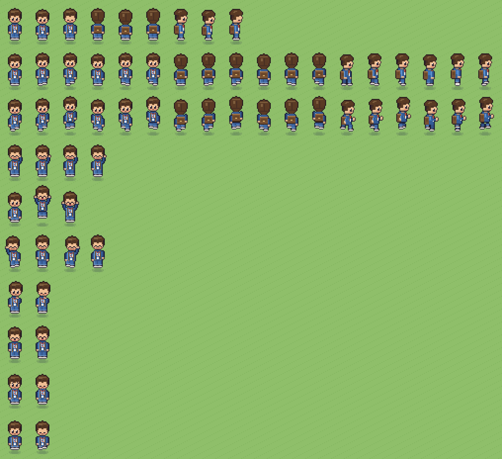 | **动作联系表**：每行一个动作（待机/走/跑各 3 个视角，其余正面） |
| 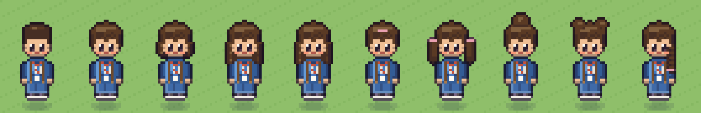 | **10 种发型**（正面） |
| 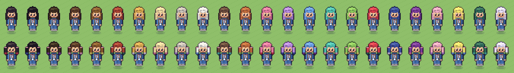 | **24 种发色**（上排长发、下排双马尾 + 发尾渐变） |
| 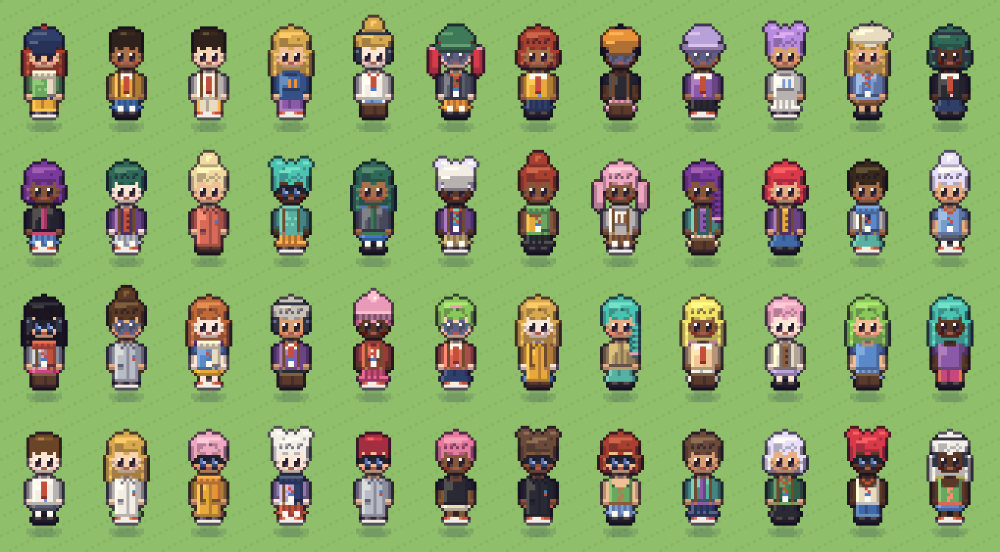 | **随机 48 个外观**：同一套代码随机抽发型/发色/肤色/衣服/帽子/配饰 |
| 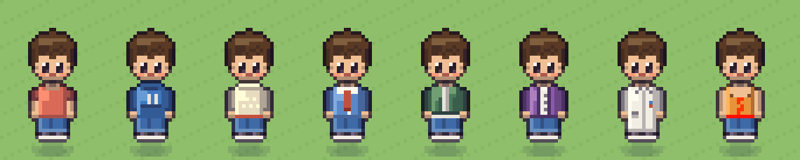 | **8 种上衣** |

**第二版精修（2026-11-02）**：
- **画布与焦点可调**：`CANVAS = { w: 24, h: 40, ox: 4, oy: 6 }`——身体仍按 16×32 比例画，画布四周留白（比旧的 16×32 宽 8、高 8），宽发型/举手/背包/帽檐不再被裁；脚点由 `FRAME` 派生（输出 26×44，脚点 (13, h-3)）。想挪动人物、再加大留白，只改这一行，预览和图集 meta 自动跟着变。
- **脖子露出来了**：头比旧版高 1 格，下巴和领口之间有一行脖子（带下巴投影），领口款式（圆领/高领/连帽）各自处理；**长发的后片改在身体后面画**，肩线、脖子都看得见，只留下垂在肩前的两缕侧发。
- **眼镜重画 4 款**，正面和侧面各一套：**墨镜**（深色渐变镜片 + 斜向高光 + 镜腿 + 鼻梁，下缘收圆）、**飞行员**（金属框 + 泪滴灰绿渐变镜片）、**粗框方镜**（黑框 + 淡蓝透明镜片）、**圆框细丝**（灰蓝细框 + 近乎透明镜片）。透明镜片下眼睛依然可见。
- 其它：背面长发加了发丝高光与参差下摆；跑步侧面的手臂改成屈肘（前臂前抬握拳 / 后摆）；刘海没盖住额头时画眉毛（难过时眉毛下压）；T 恤袖口加了一圈暗线。

| 图 | 内容 |
|---|---|
| 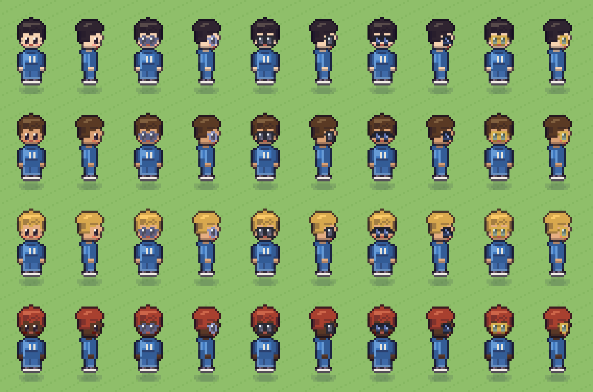 | **眼镜特写**：无 / 圆框 / 方镜 / 墨镜 / 飞行员 × 4 种肤色，每格左正面右侧面 |
| 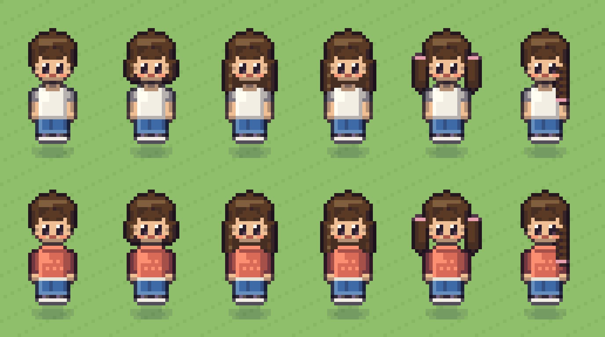 | **脖子与肩线**：短发/波波/长发/长卷/双马尾/麻花辫 × 两种上衣 |
| 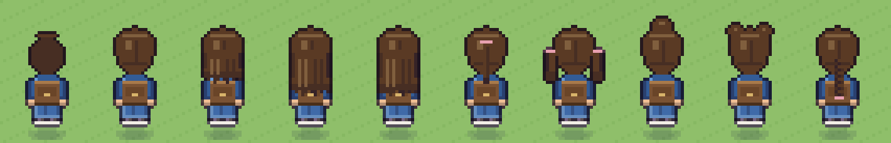 | 10 种发型的**背面** |

**第三版：2 倍分辨率 + 眼睛眼镜重画（2026-11-02）**：
- **更大尺寸**：渲染函数多了一个分辨率倍数 `k`。`k=1` 就是上面的 24×40 画布（输出 26×44）；**`k=2` 时身体按 32×64 画、输出 50×86，脚点 (25, 80)**。身体的轮廓和结构沿用同一份 Rig 数据（所有动作、发型、衣服原样可用），圆形部分在高分辨率下更圆润；**脸、眼睛、眼镜、眉毛、嘴改用原生高清像素手绘**。`npx tsx tools/art/preview-rig.ts` 同时出 `k=1` 和 `k=2`（`-hd` 后缀）两套图，方便对比。
- **眼睛重画**：不再是"2×3 的深色块"，而是 5×6 的高清眼——睫毛上线、深浅三阶的虹膜、左上白色高光、下缘亮边；**瞳色可选**（深褐/棕/蓝/绿/紫/琥珀…，`Look.eyeColor`）。眨眼、笑眼（∩）、难过（外高内低 + 眉毛下压）、张嘴（带牙和舌头）都是单独画的；眉毛在刘海没盖住额头时出现；腮红改成半透明。
- **眼镜重画 4 款**（正面 + 侧面）：
  - **墨镜**：宽顶梁 + 下缘收圆的盾形镜片，深色上深下浅渐变，斜向高光两道、下缘一圈反光，鼻梁和镜腿；镜片后面不再画眼睛，但脸颊和眉毛还露着，所以不会再像眼罩。
  - **飞行员**：金属细框 + 泪滴形灰绿渐变镜片 + 双鼻梁。
  - **粗框方镜**：黑色粗框（上沿更粗）+ 淡蓝透明镜片 + 白色高光，眼睛隐约可见。
  - **圆框细丝**：灰蓝细圆环 + 近乎透明的镜片，眼睛清楚可见。
- 脖子：高清下是"下巴投影一行 + 皮肤色一行"，不再像一条深色项圈；耳朵的阴影改成细线，不再是脏污色块。

| 图（`-hd` = 2 倍分辨率） | 内容 |
|---|---|
| 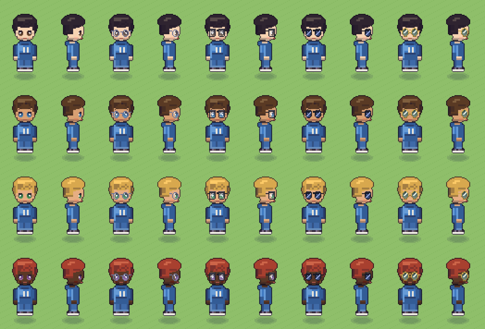 | **眼镜与眼睛特写**：无 / 圆框 / 方镜 / 墨镜 / 飞行员 × 4 肤色 × 4 瞳色，每格左正面右侧面 |
| 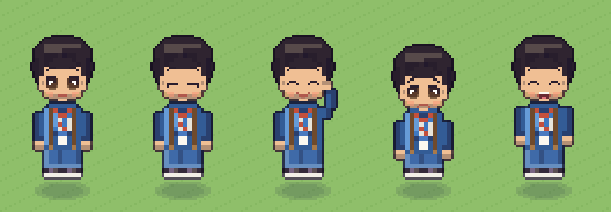 | **眼睛状态**：睁眼 / 眨眼 / 笑 / 难过 / 大笑张嘴 |
| 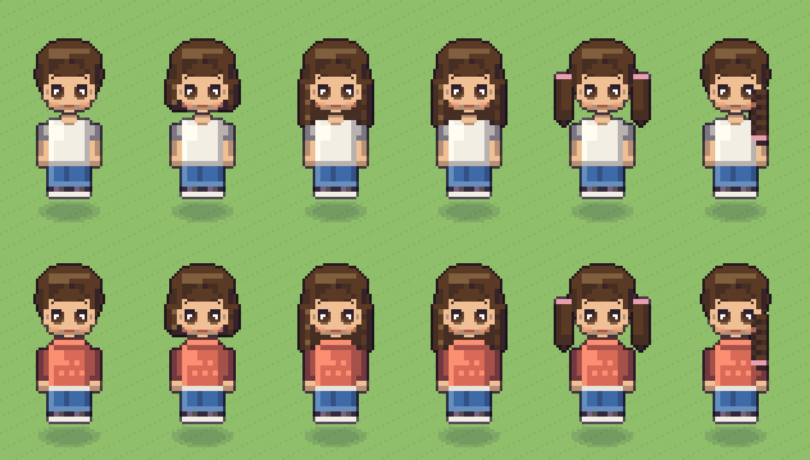 | 脖子与肩线 |
| 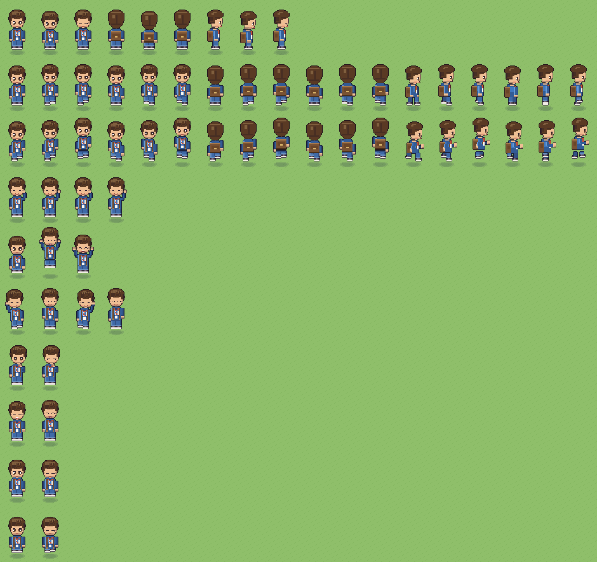 | 全部动作（2 倍分辨率） |
| 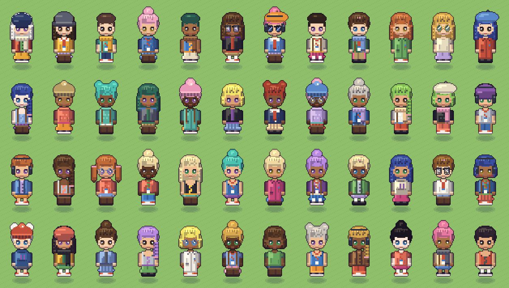 | 随机 48 个外观（含 4 款眼镜和 6 种瞳色） |

> **✅ 已决定（2026-11-02，用户拍板）：地图上的小人用 1 倍（`k=1`，32 px 高），证件照用高清（`k=2`）。**
> 理由：地图上 1 格 = 2.5 m、现有椅子/单车/猫/门都是按 32 px 人物设计的；2 倍的 64 px 小人放进去会比周围物体大一倍，缩回 0.5× 又会让像素边缘发软。所以**同一份外观数据渲染两个分辨率**：地图用 `renderFrame(…, k=1)`，学生证头像 / 创建角色预览 / 好友资料卡用 `renderPortrait()`（内部是 `k=2`）。

**证件照 `renderPortrait(look, { expr, bg })`**（[tools/art/char-rig.ts](../tools/art/char-rig.ts)）：40×58 的正面半身像（头到胸口），带渐变底色（可选）；表情 `neutral`（证件照标准脸）/ `smile` / `happy`（笑眼）。为了让大图里头发不再是一整块色面，高清下额外补了头顶弧形高光、发丝线、长发侧发丝，以及上衣的几道衣褶。

| 图 | 内容 |
|---|---|
| 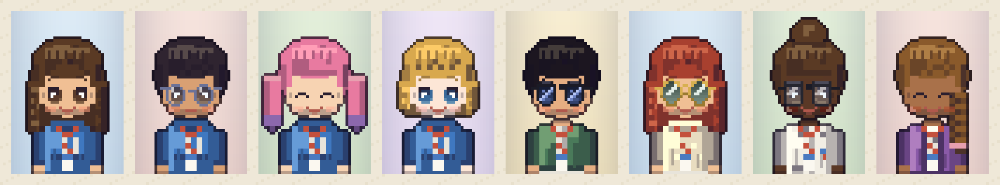 | **证件照 8 例**：不同发型/发色/渐变发尾、4 款眼镜、肤色、瞳色、上衣、表情与底色（放大 ×5） |

**接入游戏时的要点**（P2 的一部分）：
- 地图小人：图集仍是 1 倍帧（26×44），脚点 (13, h-3)，动画 key 与现有 `c{look}_…` 并存，`look<12` 的老档案走旧图集，新外观走运行时合成。
- 证件照：按 `Appearance` 现场生成一张 40×58 的 canvas（缓存），学生证、创建角色界面、好友资料卡都用它；界面上整数倍放大（×3/×4），不要用 CSS 平滑缩放（要 `image-rendering: pixelated`）。
- 创建角色界面：左边大证件照（可切表情）+ 右边选项，**选项变化即时重绘**（40×58 很便宜），另有一个小的 1 倍走路预览给玩家看地图上的样子。

**仍然存在的不足（诚实说明）**：
- 2 倍版里身体（衣服、头发的块面）仍是"原像素放大一倍"的粗块，只有脸和头发/衣服的少量细节是高清的（**混合分辨率**）；证件照只露头到胸口，影响不大；若以后想做全身大立绘，要把头发和衣服整体用高清像素重画；
- 寸头的背面是一块暗色圆，缺发旋；丸子头背面细节少；
- 表情类动作仍只有正面；侧面/背面、钓鱼、摸猫、手持物还没做；
- 还没接进游戏（没有图集、没有 `Appearance` 校验、没有创建界面）——这些是 §8.3 的 P0–P2。

---

## 11. 猫咪原型（2026-11-02，可直接看图）

和人物同样的思路：一个**独立的原型**，不动现有 `cats.ts` 和游戏代码。
- 代码：[tools/art/cat-rig.ts](../tools/art/cat-rig.ts)（外观 `CatLook` + 姿势 `CPose` + 花纹引擎 + 渲染）、[tools/art/preview-cat-rig.ts](../tools/art/preview-cat-rig.ts)（出图）。运行：`npx tsx tools/art/preview-cat-rig.ts`，图输出到 `.cache/preview/catrig-*.png`。
- **渲染方式**：先把每个像素画成"部位 + 明暗级"，**最后才按花纹引擎给每个像素选色板**——所以花纹在所有姿势里都自然跟着身体走，新增姿势不用管毛色。
- **外观参数 `CatLook`**：底色 / 副色 / 花纹（纯色、鲭鱼纹、经典旋涡纹、斑点、ticked、玳瑁、三花、van、重点色、渐层）/ 白色面积 0–4 / 瞳色（可异瞳）/ 体型（普通·胖·修长·奶猫）/ 毛（短·长）/ 耳（立·折）/ 尾（长·短·蓬松）/ 配饰（项圈·铃铛·蝴蝶结·围巾）。
- **已实现 20 种预置毛色**（§7.5 的图鉴）：橘猫、黑猫、白猫、三花、奶牛、灰猫（沿用旧版）+ 狸花、橘白、蓝白、燕尾服、玳瑁、银渐层、金渐层、银虎斑、蓝猫、奶油、暹罗、布偶、异瞳白猫、胖橘（带铃铛）。
- **侧视动作 31 个**（朝右，左向由游戏翻转）：
  - 移动：走（6 帧，参数化对角步态）、小跑（4）、奔跑（4，身体拉长、耳朵后压）、**叼鱼走**（6）、**叼银杏叶走**（6）。
  - 静止与休息：坐（4，眨眼/尾尖翘/耳抖）、香炉坐（2）、蜷成球睡（2）、侧躺睡（2）、**回头看**（3，头朝左）。
  - 日常：吃（2）、喝水（2）、舔爪（4）、理毛·后腿舔（4）、挠耳朵（4）、打哈欠（4）、喵（2）、慢眨眼（4）、伸懒腰（4）。
  - 亲近与玩耍：**蹭腿**（4）、**踩奶**（4，两只前爪交替按压）、**打滚·翻肚皮**（4）、**追尾巴**（4，头朝左追尾尖）。
  - 战斗与运动：潜行（3）、扑（5）、炸毛弓背（2）、**跳上**（5：蹲伏→起跳→腾空→落到高处→站稳）、**跳下**（4：探头→下落→落地缓冲→站起）。
  - 天气：**抖水**（4，水珠飞溅）、**抖雪**（4，白色雪花飞溅）。
- **正面/背面动作 9 个**：正面走、坐、慢眨眼、喵、香炉坐、**蹭腿**（头左右蹭，眯眼，尾巴竖起）、**踩奶**（前爪交替抬起，眯眼）；背面走、背面坐。
- **两只猫互动 4 套**（成对渲染，其中一只镜像，可以用不同毛色组合）：**互相理毛**（面对面，一只舔、一只眯眼享受）、**挤着睡**（两个毛球叠在一起）、**追逐**（前后两只奔跑）、**并排坐**（肩靠肩）。图书馆门前 4 只、同一个"家"附近的猫相遇时可触发（是否触发由 C3 的状态机决定）。
- **每帧输出锚点**（头 / 嘴 / 尾尖，输出像素坐标）：爱心、💤、叼着的鱼、"喵"气泡以后都挂在锚点上，不用每种猫重画。
- 输出每帧 38×34，脚点 (17, 25)（旧版 26×20 / (13,17)；画布大是为了容纳伸懒腰、扑、竖尾），投影与描边沿用旧版风格。

| 图 | 内容 |
|---|---|
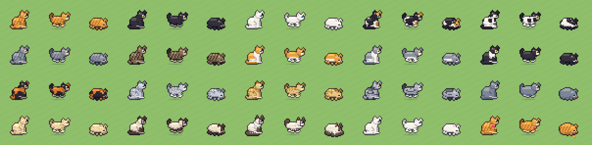
**20 种毛色**，每种三个姿势（坐 / 走 / 蜷睡）。

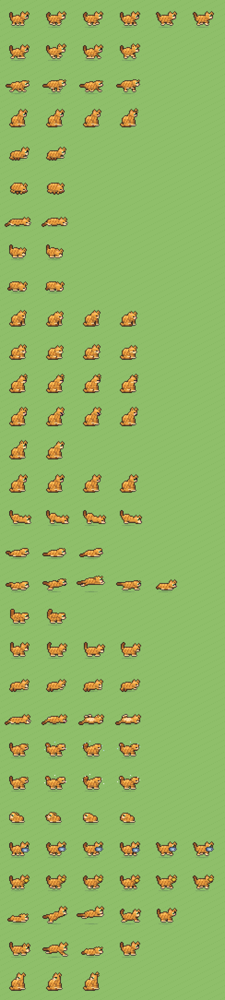
**动作联系表**：每行一个动作，帧横排。

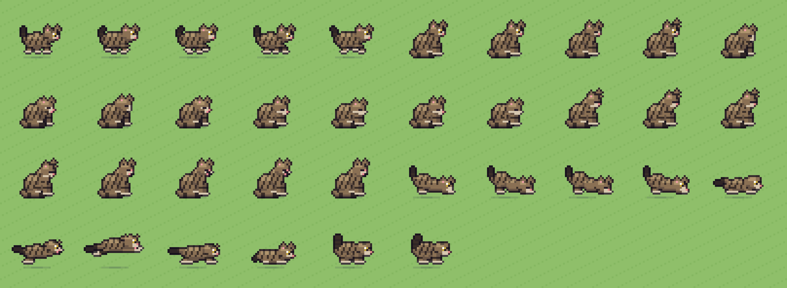
**动作放大（狸花）**：走 / 坐 / 舔爪 / 理毛 / 挠耳 / 打哈欠 / 伸懒腰 / 扑 / 弓背。

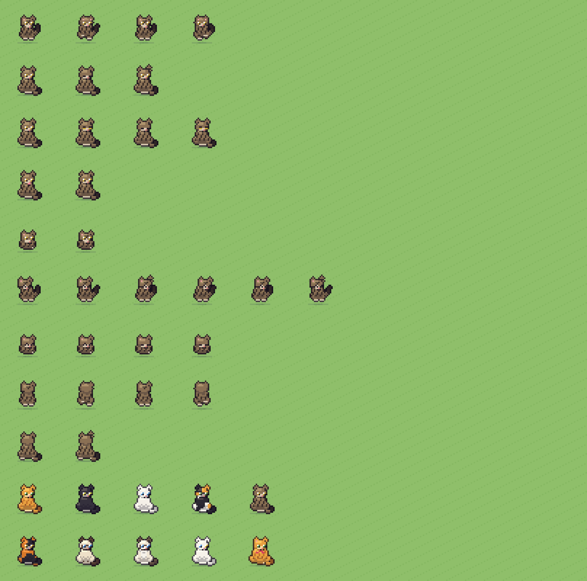
**正面 / 背面**：前 5 行是正面动作，第 6、7 行是背面，最后两行是 10 种毛色的正面坐姿。

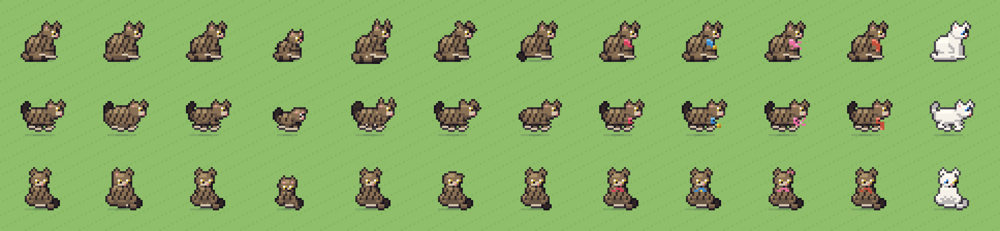
**体型与配饰**（每列：坐 / 走 / 正面）：普通、胖、修长、奶猫、长毛、折耳、短尾、项圈、铃铛、蝴蝶结、围巾、异瞳。本轮修了三处：**折耳**现在是贴着头顶、尖端前垂的小耳廓；**长毛**加了腹下参差毛边、腿后羽毛、耳尖毛和更强的脸颊毛；**配饰**改成三格厚的颈圈，铃铛/蝴蝶结/围巾尾画在轮廓外，不再被身体盖住。

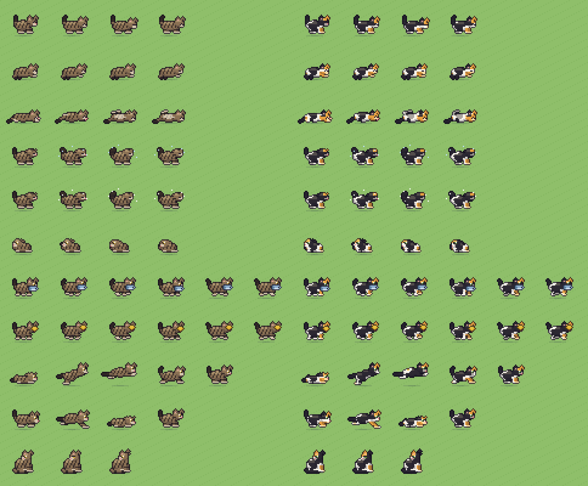
**补全的侧视动作**（左 6 列狸花、右 6 列三花；每行一个动作，依次：蹭腿、踩奶、打滚、抖水、抖雪、追尾巴、叼鱼、叼叶子、跳上、跳下、回头看）。

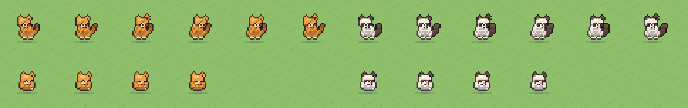
**正面蹭腿 / 踩奶**（橘猫、布偶各一行为蹭腿与踩奶）。

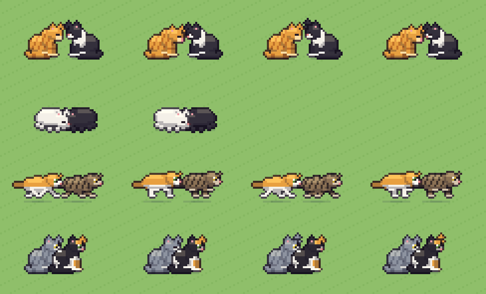
**两只猫互动**（每行一套：互相理毛、挤着睡、追逐、并排坐）。

**原型暂时的不足（诚实说明）**：
- 猫只有 38×34 的小画面，**正面和背面的脸很小**（眼睛 2×2），表情靠耳朵/眯眼/张嘴来传达；若图鉴页、猫面板想看大图，可以像人物那样做 `k=2` 的高清版；
- **追尾巴**在这个分辨率下只读成"蜷成一团的猫回头"，不够生动；**打滚**的翻身过程只有 4 帧，略生硬；**跳上/跳下**只画了身体形变，弧线位移要由游戏按帧移动精灵；
- 叼着的鱼/叶子目前固定在嘴部锚点，没有随步态晃动；
- **动作只做了姿势表**，**还没接状态机**（`Cat.ts` 的好感度/时间/天气联动是 C3；比如"抖水/抖雪"该由下雨下雪触发、"蹭腿/踩奶/挤着睡"该由好感度档位解锁）；也没接进图集和游戏；
- 老猫毛色冻结的方案（§7.6）只是设计，代码里的 `cats.ts` 和 `shared/cats.ts` 一行没动；
- §7.2 的动作清单到此**已全部覆盖**（"跳上长椅"只做了动画，没有和长椅碰撞/锚点联动）。

---

## 12. 接入游戏（2026-11-02 第一批）

**已接入**（本地，未提交/部署）：
- **管线**：`tools/art/index.ts` 改用 Rig 生成 `atlas-chars`（12 预置 × 79 帧，每帧 26×46）、`atlas-portraits`（12 × 2 表情的证件照）、`atlas-cats`（6 毛色 × 143 帧，每帧 38×34）；`chars-meta.json` / `cats-meta.json` 带着所有动作的帧数、帧率、视角，`BootScene.makeAnimations` 据此建动画，不在代码里写死。旧版帧名 `c{n}_{dir}_0`、`cat{c}_sit_0`、`cat{c}_sleep_*` 保留为别名。
- **人物**：`Character.play()` 按 待机 / 走 / 跑 / 表情姿势 选动画；`running` 标志取代手改 `msPerFrame`（别人的奔跑来自同步的 run 标志）；行人走得慢，动画 `timeScale=0.6`；`EmoteDef.pose` 把 9 个表情映射到姿势动画。
- **小猫**：`Cat.ts` 重写状态机——视角（侧视/正面/背面）、权重表（时间/天气/好感度）、雨雪停了抖水抖雪、睡醒伸懒腰再打哈欠；`Cat.env` 由 `WorldScene` 每帧写入。
- **界面**：学生证照片、左上角头像、好友头像改用证件照；创建角色的造型按钮用全身裁切；CSS 尺寸随新画幅调整。
- **测试**：`tests/art-rig.test.ts`（14 项）。写测试时它抓出了一个真问题：跳起/腾空帧里丸子头会顶出画布，已把画布顶部留白加到 8 行、欢呼的腾空高度降一格。

**P2 外观自定义（同日第二批，已做）**：
- `src/shared/appearance.ts`：17 个选项编号的外观数组、色板（肤色 8 / 发色 24 / 服装色 24 / 瞳色 6）、选项名、`parseAppearance`（服务器逐项校验）、`appKey`、`randomAppearance`；
- `Profile.app?` → `PublicProfile` / `PersonInfo`；`validateProfile` 丢弃非法外观而不拒绝档案；`look` 仍必填（预置底子 + 别人生成好之前的临时造型）；
- `src/art/px-core.ts`（去 sharp 的像素内核）+ `src/art/char-rig.ts`（Rig，`appToLook` / `lookToApp` / `presetApp`）→ 浏览器与脚本共用；
- `src/art/skins.ts`：`SkinManager` 运行时合成（分帧生成 → 拼图集 → 建动画 → LRU 48 套、引用计数），`Character` 按 `skin` 前缀 + `texKey` 播放；
- 创建角色 / 修改资料：6 个分页（发型/脸/上衣/下装/鞋帽/配饰）+ 色板 + 开关 + 🎲 + 还原预置，右侧高清证件照与"地图上的样子"走路动画即时刷新；
- 测试：`tests/appearance.test.ts`（含随机外观不碰画布边缘）+ 1 条服务器测试。

**第三批（同日，已做）**：
- **新毛色启用**：`allCats` 在图书馆猫之后追加 14 只新毛色的猫（32–45 号，`genNewCats`，家从行人出生点按固定种子挑、离已有的猫至少隔开），老猫（0–31 号）的毛色/名字/编号冻结；图集扩到 20 种毛色。
- **人物姿势**：长椅坐姿（`sit`）、摸猫/喂猫蹲下伸手（`crouch`，四方向）、钓鱼持竿（`fish` / `fish_bite`）；`Character.play()` 按 坐 / 骑车 / 表情 / 钓鱼 / 蹲 / 移动 选动画。
- **小猫行为**：潜行→扑（连招）、追尾巴；雨伞颜色随自定义外观的上衣色。

**第四批（同日，已做）**：
- **手持物**：`shared/held.ts`（6 件、编号、`cleanHeld`）+ `src/art/held.ts`（每件 3 个视角的像素图，`atlas-held`）；`Character.setHeld/syncHeld` 按朝向挂在胸前或身侧；`held` 协议消息 + spawn 的可选 `held`；V 键 / 菜单切换。
- **猫图鉴**：`COAT_LABELS` / `COAT_RARITY`（沿用钓鱼的稀有度颜色），动物图鉴新增毛色收集分组与稀有度进度。

**还没接**（下一批）：
1. 更衣入口（现在只能在"修改资料"里改外观）与**外观的获取方式**（商店/成就/季节限定——现在全部免费开放）；
2. 手持物目前是"贴"在手上的小图，手臂还不会随之摆姿势（书/手机/相机应该配"双手捧着"的手臂姿势）；手持物的获取方式（商店买/成就）；
3. 小猫：猫面板里的大图、跳上跳下/叼鱼/两猫互动的行为接入；
4. NPC 仍只用预置外观；
5. 把表情的 `anim`（抖动/跳）彻底删掉，只留 `pose`。

---

## 13. 来源
- [Universal LPC Spritesheet Character Generator](https://github.com/LiberatedPixelCup/Universal-LPC-Spritesheet-Character-Generator)（README、ARCHITECTURE.md、`sources/state/constants.ts`；动作表、帧大小、图层与 z 排序）
- [lpcg（Rust）](https://docs.rs/crate/lpcg/latest)
- [Stardew Valley Wiki · Modding:Farmer sprite](https://stardewvalleywiki.com/Modding:Farmer_sprite)（抓取被拒，仅引用搜索摘要）
- [Wikipedia · Cat coat genetics](https://en.wikipedia.org/wiki/Cat_coat_genetics) · [Wikipedia · Cat behavior](https://en.wikipedia.org/wiki/Cat_behavior)
- itch.io / OpenGameArt（仅参考动作清单与帧数规格）：[zegley 俯视角角色模板](https://zegley.itch.io/2d-pixel-art-top-down-character-template) · [Moonforge](https://moonforgestudios.itch.io/pixelart-characters-base) · [tampg 2D explorer](https://tampg.itch.io/2d-explorer-character-sprite) · [bragorn 猫动画集](https://bragorn.itch.io/pixel-cat-animation-set) · [girlypixels 猫](https://girlypixels.itch.io/animated-cat-sprites) · [OpenGameArt 猫](https://opengameart.org/content/pixel-art-cat-doing-some-stuff)
